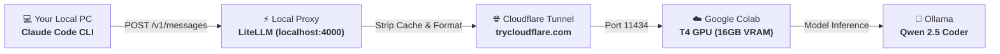

# 🚀 Free Claude Code CLI with Google Colab (Zero API Cost, Unlimited Compute)

[](https://opensource.org/licenses/MIT)
[](https://colab.research.google.com/)
[](https://www.python.org/)
[](https://claude.ai/code)

Run Anthropic's **Claude Code CLI** completely **FREE** without paying for Anthropic API credits or needing an expensive local GPU!

This project bridges **Claude Code** to a free **16GB T4 GPU on Google Colab** running **Ollama (Qwen 2.5 Coder)**, exposed through an encrypted Cloudflare Tunnel and routed through a local LiteLLM proxy.

---

## 🌟 Architecture



---

## ⚡ Why Use This?

- **100% Free:** Zero subscription, zero Anthropic API bills ($0/month).
- **Zero Local GPU Required:** All heavy AI computation runs on Google's cloud servers (16GB T4 GPU).
- **No Daily Request Limits:** Code as much as you want without 15 RPM throttling or token quotas.
- **Top Coding Model:** Runs **Qwen 2.5 Coder** (7B or 14B), which rivals GPT-4o-mini in coding benchmarks.

---

## 📋 Prerequisites

1. **Python 3.10+** installed on your computer.
2. **Claude Code CLI** installed:
   ```bash
   npm install -g @anthropic-ai/claude-code
   ```
3. A Google Account (for Google Colab).

---

## 🚀 Quick Setup (3 Minutes)

### Step 1: Start Free Cloud GPU in Google Colab

1. Open [Google Colab](https://colab.research.google.com/).
2. Click **File** > **Open Notebook** and upload `colab_notebook.ipynb` (or copy-paste `colab_server.py` into a new notebook cell).
3. Select GPU Runtime: **Runtime** > **Change runtime type** > Choose **T4 GPU** > **Save**.
4. Run the code cell!
5. After ~1-2 minutes, copy the public URL printed at the bottom:
   ```text
   🎉 YOUR FREE OLLAMA PUBLIC TUNNEL URL IS READY:
   👉 https://your-subdomain.trycloudflare.com
   ```

> ⚠️ **Important:** Keep the Colab browser tab open while coding.

---

### Step 2: Configure Local Proxy

1. Clone this repository:
   ```bash
   git clone https://github.com/your-username/claude-code-free-colab.git
   cd claude-code-free-colab
   ```

2. Install dependencies:
   ```bash
   pip install -r requirements.txt
   ```

3. Open `litellm_config.yaml` and replace `YOUR_CLOUDFLARE_TUNNEL_URL` with your Colab tunnel URL:
   ```yaml
   model_list:
     - model_name: "claude-3-5-sonnet-20241022"
       litellm_params:
         model: "ollama/qwen2.5-coder:7b"
         api_base: "https://your-subdomain.trycloudflare.com"
   ```

---

### Step 3: Configure Claude Code to Use Local Proxy

Edit your Claude Code settings file located at:
- **Windows:** `C:\Users\<YourUsername>\.claude\settings.json`
- **macOS / Linux:** `~/.claude/settings.json`

Set the configuration to:

```json
{
  "env": {
    "ANTHROPIC_BASE_URL": "http://127.0.0.1:4000",
    "ANTHROPIC_AUTH_TOKEN": "sk-litellm-free",
    "ANTHROPIC_MODEL": "claude-3-5-sonnet-20241022",
    "ANTHROPIC_DEFAULT_HAIKU_MODEL": "claude-3-5-haiku-20241022",
    "ANTHROPIC_SMALL_FAST_MODEL": "claude-3-5-haiku-20241022"
  },
  "model": "claude-3-5-sonnet-20241022"
}
```

---

### Step 4: Run Claude Code!

#### On Windows:
Double click **`start_proxy.bat`** (or run `.\start_proxy.ps1` in PowerShell).

#### On Linux / macOS:
```bash
chmod +x start_proxy.sh
./start_proxy.sh
```

Now Claude Code is completely live and coding using your free Google Colab GPU backend! 🎉

---

## 🧠 Model Upgrades (7B vs 14B)

By default, the script loads `qwen2.5-coder:7b` (fast, uses ~4.5 GB VRAM).

If you want **significantly smarter coding and reasoning** (GPT-4o-mini level), you can switch to `qwen2.5-coder:14b`:

1. In Google Colab, change `MODEL_NAME`:
   ```python
   MODEL_NAME = "qwen2.5-coder:14b"
   ```
2. In `litellm_config.yaml`, update the model parameter:
   ```yaml
   litellm_params:
     model: "ollama/qwen2.5-coder:14b"
   ```

*(The 14B model uses ~9 GB VRAM, fitting comfortably within Colab's 16 GB T4 GPU).*

---

## 🛠️ Troubleshooting

### 1. `Error 403 Forbidden` from Cloudflare Tunnel
- **Cause:** Ollama blocks external Host/Origin headers by default.
- **Solution:** Ensure `OLLAMA_ORIGINS="*"` and `--http-host-header localhost:11434` are set as implemented in `colab_server.py`.

### 2. `zstd extraction error` on Colab
- **Cause:** Colab environments sometimes miss `zstd`.
- **Solution:** `colab_server.py` automatically installs `apt-get install -y zstd`.

### 3. `TotalCachedContentStorageTokens limit exceeded`
- **Cause:** Claude Code injects ephemeral prompt caching blocks that unsupported providers reject.
- **Solution:** `strip_cache.py` is included as a LiteLLM pre-call hook to automatically sanitize caching blocks.

---

## 📜 License

This project is licensed under the [MIT License](LICENSE).
